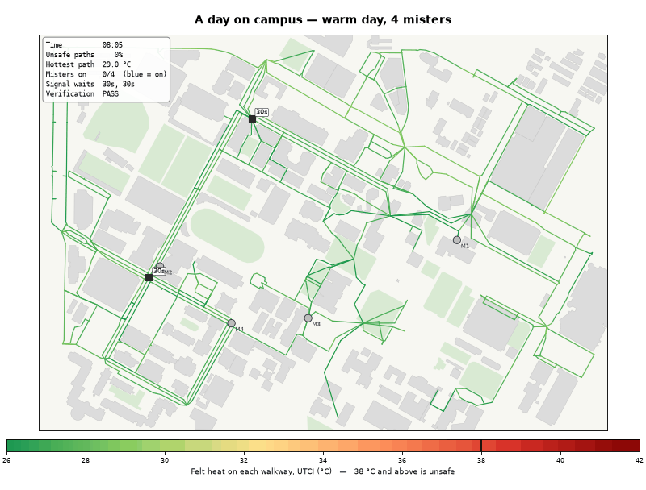
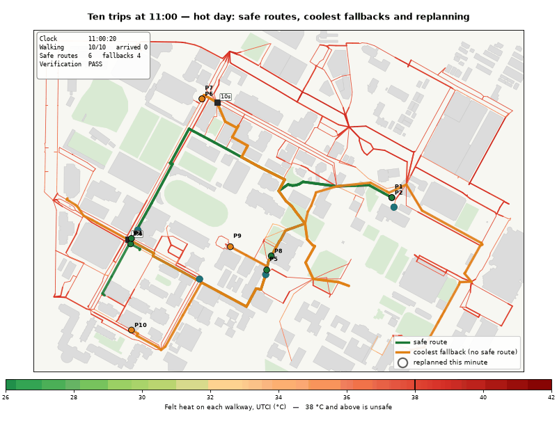

# Dynamic Cool Corridor System

New developers and GPT sessions should begin with [HANDOFF.md](HANDOFF.md).

## Python version

- 3.12

## Java requirement

The MoonLight STREL engine requires Java 21 or newer and a `JAVA_HOME`
environment variable that points to the installed JDK.

## Environment setup

Create and activate a virtual environment, then install the project
dependencies:

```powershell
python -m venv .venv
.\.venv\Scripts\Activate.ps1
python -m pip install -r requirements.txt
```

The root requirements install pythermalcomfort for UTCI calculations and MoonLight 0.3.1 for STREL.
OSMnx and plotting packages are optional, for rebuilding/running the standalone prototype.

## Project structure

- DynamicCoolCorridorSystem/
    - utils/
        - graph/ (shared nodes, edges, actuators, graph state, and JSON loading)
        - pipeline/ (shared model input and output contracts)
    - models/
        - _template/ (copyable, human-editable model starter)
        - environment/ (weather, generated or scheduled shade, and mist cooling)
        - heat_exposure/ (UTCI, exposure, and unsafe-heat flags)
        - control/ (mister commands and traffic-signal waits)
        - routing/ (heat-weighted route assignment; optional demo/ and osm_build/ tools)
        - pedestrian/ (persistent movement, signal waits, and occupancy)
        - verification/ (final hybrid STREL and Python requirements verifier)
    - dataset/
        - usc_osm_trimmed/ (default: 832 nodes and 930 real-map segments)
        - campus_50/ (50-node fictional grid with a shade schedule)
        - tiny_campus_block/ (9-node fictional test graph)
    - tests/ (automated model and graph utility checks)
    - main.py
    - requirements.txt

## Creating a model

Start with [`models/_template`](models/_template/README.md). Each model keeps
human-tunable values in a small `config.json`, declares zero or more input
and output properties, and exposes the shared Python input/output interface.
Models that only update existing graph state may report no output properties.

Run the template example and checks from the project root:

```powershell
python -m models._template.model
```

## Running the pipeline

Run every configured model stage from the project root:

```powershell
python main.py
```

Select one of the proposed USC misting layouts without copying the map:

```powershell
python main.py --misting-count 4 --debug-dir debug/misting-4
python main.py --misting-count 6 --debug-dir debug/misting-6
python main.py --misting-count 10 --debug-dir debug/misting-10
python main.py --misting-count 0 --debug-dir debug/misting-0
```

The layouts use the first 4, 6, or 10 ordered placements in
`dataset/usc_osm_trimmed/misting_scenarios.json`; zero is the no-misting baseline.
Only misting actuators are replaced in memory. Existing signals, map geometry,
buildings, and shade are shared. Every mister starts off and uses the same 10.8 F
full cooling strength. Walkways are cut where they cross a mister's circle, so
only the piece inside the circle is cooled (17 walkways cut for 4 misters, 49 for 10). Control switches misters
on at 35 C and off below 33 C of uncooled UTCI (see `models/control/README.md`). The environment configuration supplies the shared radius
(currently 10 m); startup rejects overlapping or touching cooling circles and
invalid anchors. Placement names refer to hypothetical locations on the graph.

Omitting `--misting-count` preserves the dataset's original actuators (two
misters on USC). Explicit scenarios require a matching `misting_scenarios.json`
in the selected dataset; these layouts are provided only for USC. Debug outputs
from every stage record `diagnostics.misting_scenario`, including count, radius,
positions, cooling strengths, and preserved non-misting actuator IDs. Keep trips,
weather, rounds, and pedestrian timestep equal when comparing layouts. The zero
baseline retains signal control, so it isolates the effect of adding misting.

Save the complete output of each stage for debugging:

```powershell
python main.py --debug-dir debug
```

The dataset is loaded once. Initialization runs Environment -> Heat Exposure
to supply the controller's inputs. Each round then runs Control -> Environment
-> Heat Exposure -> Routing -> Pedestrian -> Verification, carrying the updated graph into the next round.
One pedestrian simulator is reused for every round. By default,
one round runs after initialization. Choose a positive number of rounds:

```powershell
python main.py --rounds 5 --time 13:00 --scenario hot --debug-dir debug
```

With `--time`, time and scenario stay fixed across rounds. Each round's environment applies
the latest misting commands, then heat exposure is recalculated. Final heat
results reflect the final round's misting state. Signals reflect the control
decision made at the start of that round. Legacy directional LEDs pass through
unchanged; the controller does not update them.

Debug files are grouped under `initialization/` and `round_001/`, `round_002/`,
and so on. The completion output lists final actuator states.

### Simulating a daytime range

`--time-range` advances the clock through the day instead of holding `--time`
fixed. The flag alone simulates 08:00 to 17:00:

```powershell
python main.py --time-range --misting-count 4
python main.py --time-range 11:00-15:00 --trips models/routing/example_trips.json
python main.py --time-range --pedestrian-dt 300 --env-update-min 60
```

Each round advances the clock by `--pedestrian-dt` (default 60 s in this mode),
so the default day is 540 one-minute rounds, about 2 minutes of runtime on USC.
Environment refreshes weather and shade every `--env-update-min` minutes (default 30),
counted from the start time. Rounds between refreshes reuse the latest refresh time.
Control, Heat Exposure, Routing, Pedestrian and Verification still run every round.
`--rounds` is optional here and may stop the run early, but never past the end
time. The range must lie within Environment's sunrise and sunset hours
(06:00-20:00). The scenario stays fixed for the whole day. A full day with
`--debug-dir` writes 540 round folders, so leave that option out unless you need it.

`build_initialization_pipeline()` defines the initialization stages;
`build_pipeline()` defines one round. `run_pipeline()` executes a single pass,
and `run_simulation()` initializes and repeats the rounds. The final output is
the verification audit, preserving pedestrian diagnostics and environmental/heat properties. Each stage receives
the graph produced by the previous stage, including accumulated properties.

## Requirements verification audit

Verification audits every round without changing routes, commands, or movement.
It requires a safe route whenever one exists; otherwise it checks the coolest
fallback by cumulative exposure, then hottest segment, then travel time. The 2.5x
arrival bound is checked independently and never restricts route selection.
All checks use current conditions; there is no heat prediction or forecast input.

Run automated USC audit checks using real upstream model evidence:

```powershell
python -m unittest tests.verification.test_model
```

Per-pedestrian results, actuator checks and round history are in
`diagnostics.verification`, saved as `round_001/06_requirements_verification.json`
when debugging is enabled. Routing now follows the same safe-first and
coolest-fallback policy and replans walking pedestrians; verification still
audits it independently and never changes routes. See
[`models/verification/README.md`](models/verification/README.md) for scope,
input evidence, result codes and commands.

## Animations

`tools/make_animations.py` renders four GIFs from real pipeline runs on the USC
map into `docs/animations/`. Walkways are coloured by felt heat (UTCI; 38 C and
above is unsafe, drawn thicker), misters are blue when on, and signals show
their current wait. Buildings and green areas come from the bundled OSM file.

| GIF | What it shows |
| --- | --- |
| `1_day_on_campus.gif` | Warm day 08:00-18:00, 4 misters: heat builds and fades; misters switch on about 12:30 and off at 17:30 |
| `2_ten_trips.gif` | Hot day from 11:00, 10 pedestrians: safe routes (green), coolest fallbacks (orange), replanning and the Verification result |
| `3_with_misters.gif` | Hot day 10:00-17:00 with 10 misters, with a close-up of one mister zone |
| `4_without_misters.gif` | The same day and close-up with no misters, for comparison |




Install the optional plotting packages once, then render (about 2-3 minutes):

```powershell
python -m pip install -r tools/requirements.txt
python tools/make_animations.py all
```

Use `day`, `trips` or `misting` instead of `all` to render one set. The script
records a small snapshot each round through `run_simulation(on_round=...)`,
so it writes no debug files. The trips GIF uses `models/routing/example_ten_trips.json`.

## Automated tests

All automated tests are organized under [`tests/`](tests/README.md). The coverage
guide explains the behaviors checked, datasets, prerequisites, and known gaps.
Run the full suite from the repository root:

```powershell
python -m unittest discover -s tests -t . -v
```

Standalone model demos remain available for inspecting outputs; automated tests
run separately and do not run automatically during the pipeline or demos.

## Datasets

The project runs and tests only on `dataset/usc_osm_trimmed`.
`dataset/campus_50` and `dataset/tiny_campus_block` stay in the repository for
reference and for their schema documentation, but the pipeline, demos and
automated tests no longer use them.

## Routing and pedestrians on the real USC map

The default dataset is now `dataset/usc_osm_trimmed`, exported from routingc's
OSM network. See [map assumptions](dataset/usc_osm_trimmed/README.md): real
walkway geometry, assumed shade/weather, hypothetical misters and signals.

```sh
python main.py --trips models/routing/example_trips.json --rounds 15 --pedestrian-dt 60 --debug-dir debug/real-campus
```

Routingc computes paths before Pedestrian moves. The example requests two
Leavey → SGM trips with preferences 0 and 1; they are assigned once, retain
progress between rounds, and have their remaining route re-checked each round. Without --trips, config requests four trips once.
Routing diagnostics are saved as `round_001/04_routingc_model.json`; movement
snapshots are in `05_pedestrian_simulation.json` each round.

See [routing contract and limitations](models/routing/README.md) and
[pedestrian state/movement](models/pedestrian/README.md). Routing reads the
current Heat Exposure output, converts it to comfort weights, and uses
routingc's shared search/cost functions. The final audit uses STREL for
selected-route safety; routing itself remains unchanged.

In the runner, legacy --routes supplies origin/destination endpoints and
routingc recomputes the intermediate nodes. Use USC node IDs or building names;
the older campus_50 route examples are not used.

With --time, environment time/weather remain fixed; with --time-range they follow the
clock. --pedestrian-dt advances walking and signal waiting.
Pedestrians execute controller-provided signal waits at controlled departures.
See the [routing limitations](models/routing/README.md#verification-policy-and-remaining-limitations)
and [pedestrian limitations](models/pedestrian/README.md#current-limits).

## Signal-wait example

```sh
python main.py --trips models/routing/example_signal_trips.json --rounds 2 --pedestrian-dt 60 --debug-dir debug/signal-waits
```

These Olin ↔ SGM trips cross SIM_S2 and wait before proceeding. The original
Leavey ↔ SGM example bypasses the configured signals. Wait countdowns persist
between rounds; total_travel_time_sec remains walking time and
total_wait_time_sec records actual waiting. See models/pedestrian/README.md
for departure matching, concurrent signals and the fixed-delay assumption.
